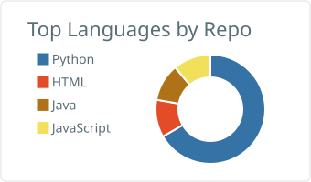
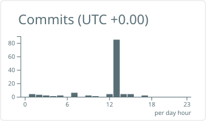
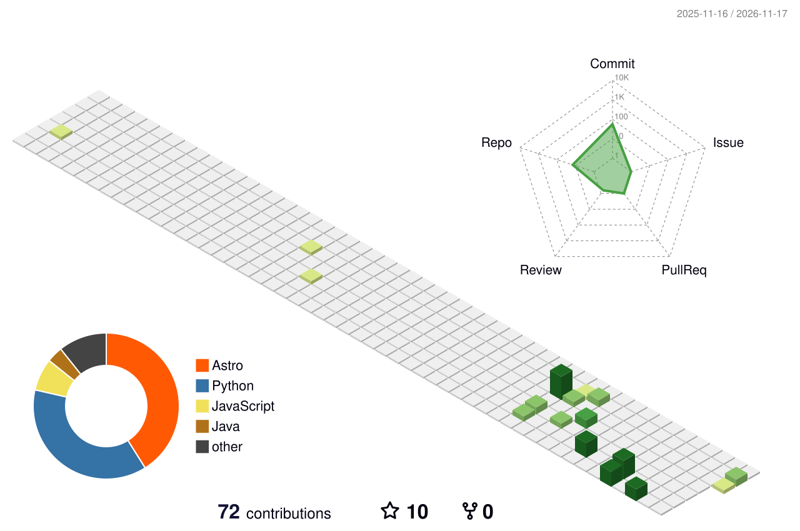

# Hi, I'm KBber

**Building reliable LLM Agents** — Agent 评测 · 证据溯源 · 上下文工程

```
Agent Reliability Engineering  ·  Evidence-Grounded AI  ·  Context Engineering
```

---

## 我在解决什么问题

大模型能干活，但不能**信**。答案里混着一个编造的财务数字、一次无法追溯的结论、一段没有来源的引用 —— 这些在真实业务里是致命的。

我的工作聚焦在让 LLM 系统具备工程属性：

| 方向 | 具体问题 | 方法 |
|---|---|---|
| **三态决策** | LLM 输出无法用 true/false 断言 | `PASS / FAIL / REVIEW_REQUIRED` + 人工兜底通道 |
| **证据溯源** | 结论凭什么可信 | 每个数字/结论绑定 `page + bbox`，可点开原文 |
| **失败分类** | 出错了不知道为什么错 | Failure Taxonomy + Precondition + Trace ID |
| **上下文工程** | 多轮追问就"忘了"前面说过什么 | 实体追踪 + 指代消解 + 短期记忆 |
| **评测基准** | 没人说清楚"什么算好" | 自建垂类 benchmark + 多模型量化对比 |

---

## 精选项目

| 项目 | 一句话 | 技术栈 |
|---|---|---|
| **[finverify](https://github.com/KBber/finverify)** | 财报数字溯源 —— 每个财务数字都能点开看到原文出处 | Python · PyMuPDF · RAG · Benchmark |
| **[graphrag-financial-report](https://github.com/KBber/graphrag-financial-report)** | GraphRAG 处理上市公司年报，多跳财务查询 | GraphRAG · Neo4j · FastAPI · Ragas |
| **[react-llm-memory-agent](https://github.com/KBber/react-llm-memory-agent)** | Agent 记住"那另一家呢"这类追问 | ReAct · Memory · Entity Tracking |
| **[video-skills-repo](https://github.com/KBber/video-skills-repo)** | 将 5 套共 26 个视频 Agent Skills 打包成可一键部署的工具集 | MiniMax Code · HyperFrames · Remotion · Video Use |

## 近期本地项目

- **TenderGuard v0.4** · 招投标合规审查。通过混合检索找回原文证据，再用规则引擎校验，证据不足或冲突时转人工复核。
- **PosePilot** · 离线拍照姿势灵感册。按咖啡馆、街拍、旅行等场景查姿势示意图、动作步骤和手机机位，支持收藏拍摄清单。
- **vibe-knowledge-film** · 知识短视频制作 Skill。从选题或文案生成字幕、分镜和动效工程，先产出约 30 秒样片供确认。

## 技术栈

**语言与后端**　Python（异步并发）· FastAPI · Linux · 异步 IO
**AI 应用**　　　Agent Workflow · RAG · GraphRAG · 混合检索（BM25 + Vector）· 工具调用
**LLMOps**　　　　LangSmith · Phoenix · Ragas · Trace / Evaluation / Debug
**模型**　　　　　GPT · DeepSeek · Qwen · 开源与闭源混合
**数据**　　　　　Neo4j · FAISS · Pydantic 强类型 Schema

---

## 关于我

- 🎓 燕山大学 · 计算机科学与技术
- 💼 AI 应用工程 / 解决方案落地 —— 金融与政企场景的 LLM 系统从 PoC 到生产
- 🏷️ Agent Loop · Harness Engineering · Context Engineering
- 📍 开放远程协作

---

## GitHub 活动

<table>
  <tr>
    <td></td>
    <td></td>
  </tr>
  <tr>
    <td></td>
    <td></td>
  </tr>
</table>



<picture>
  <source media="(prefers-color-scheme: dark)" srcset="https://raw.githubusercontent.com/KBber/KBber/main/assets/github-snake-dark.svg">
  
</picture>

## 联系我

[](https://github.com/KBber)

[个人网站](https://kbber.github.io/) · [全部公开仓库](https://github.com/KBber?tab=repositories)

欢迎交流 Agent 评测方法、证据溯源设计、RAG 落地踩坑。
