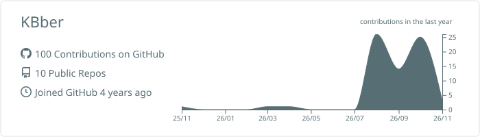
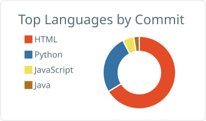

# KBber · AI 应用工程

我做面向金融文档和业务审核的 LLM 应用，主要解决三件事：**答案能回到原文、审核有明确规则、多轮对话能跟住上下文。**

## 精选项目

### [finverify](https://github.com/KBber/finverify) · 财报数字溯源与校验

把抽取出的财报数字关联到 PDF 页码、坐标和表格单元格，点击数字可高亮原文。用会计勾稽关系检查数字是否一致，输出 `PASS`、`FAIL` 或 `REVIEW_REQUIRED`，方便人工定位证据并复核。

**实现** · Python、PyMuPDF、规则校验、命令行与浏览器演示。

### [graphrag-financial-report](https://github.com/KBber/graphrag-financial-report) · 上市公司年报多跳问答

把年报中的实体和关系建成 Neo4j 知识图谱。用局部检索查具体公司或指标，用全局检索处理跨主题问题，支持需要串联多处信息的财务查询。

**实现** · GraphRAG、Neo4j、FastAPI、Ragas。

### [react-llm-memory-agent](https://github.com/KBber/react-llm-memory-agent) · 多轮财务问答 Agent

当用户追问「那另一家呢？」时，从会话中恢复候选公司，把追问改写为明确的问题再检索。短期记忆按会话持久化，项目记录了 36 个单元测试和端到端对照用例。

**实现** · ReAct、实体追踪、指代消解、会话级 JSON 存储。

### [video-skills-repo](https://github.com/KBber/video-skills-repo) · 视频技能打包与部署

把 HyperFrames、Remotion 等 5 套上游工具的 26 个 Agent Skills 打包到同一安装流程。提供 Windows 和 macOS/Linux 安装脚本，检查运行时依赖，并按 MiniMax Code 的规则验证技能能否被发现。

**实现** · PowerShell、Bash、Python、GitHub Actions。

## 本地项目

- **TenderGuard v0.4 · 招投标合规审查**。保留 PDF 的段落和表格坐标，用 BM25 与向量检索召回证据，再由规则引擎校验。证据不足或冲突时转人工复核，评测按检索和端到端决策分别运行。
- **PosePilot · 离线拍照姿势工具**。把场景、姿势示意、动作拆解和手机机位组织成可按场景浏览和收藏的页面，可离线打开。提供构建校验和浏览器端到端测试命令。
- **vibe-knowledge-film · 知识短视频制作 Skill**。从选题或文案生成字幕稿、分镜和动效代码，先输出约 30 秒样片确认节奏和风格，再按同一流程做全片。

## 技术方向

- **LLM 应用与评测** · ReAct、工具调用、会话记忆、端到端回归和检索消融。
- **文档与检索** · 版面解析、结构化抽取、BM25 / 向量混合检索、Neo4j。
- **工程与交付** · Python、FastAPI、Pydantic、pytest、GitHub Actions。

**教育背景** · 燕山大学，计算机科学与技术

## GitHub 活动

<table>
  <tr>
    <td></td>
    <td></td>
  </tr>
  <tr>
    <td></td>
    <td></td>
  </tr>
</table>

<picture>
  <source media="(prefers-color-scheme: dark)" srcset="https://raw.githubusercontent.com/KBber/KBber/main/assets/github-snake-dark.svg">
  
</picture>

[全部公开仓库](https://github.com/KBber?tab=repositories)
